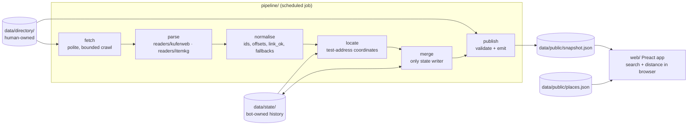
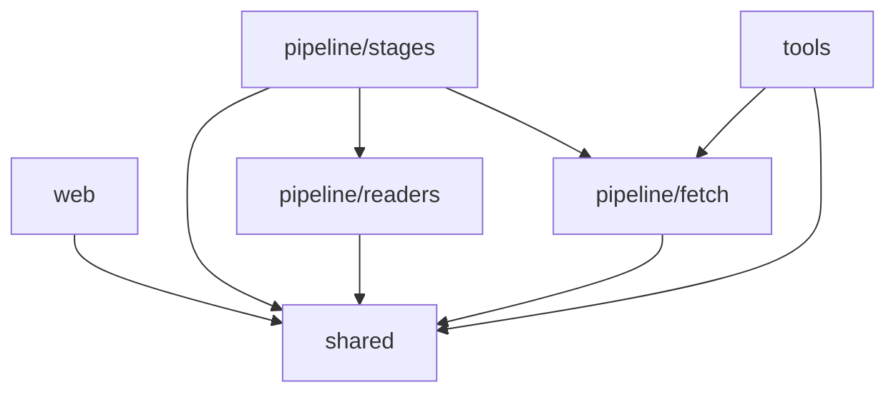
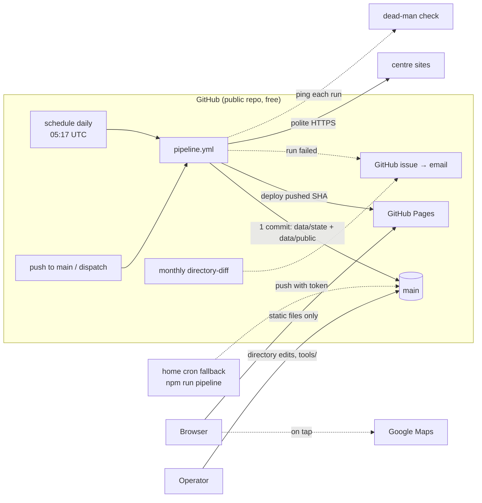
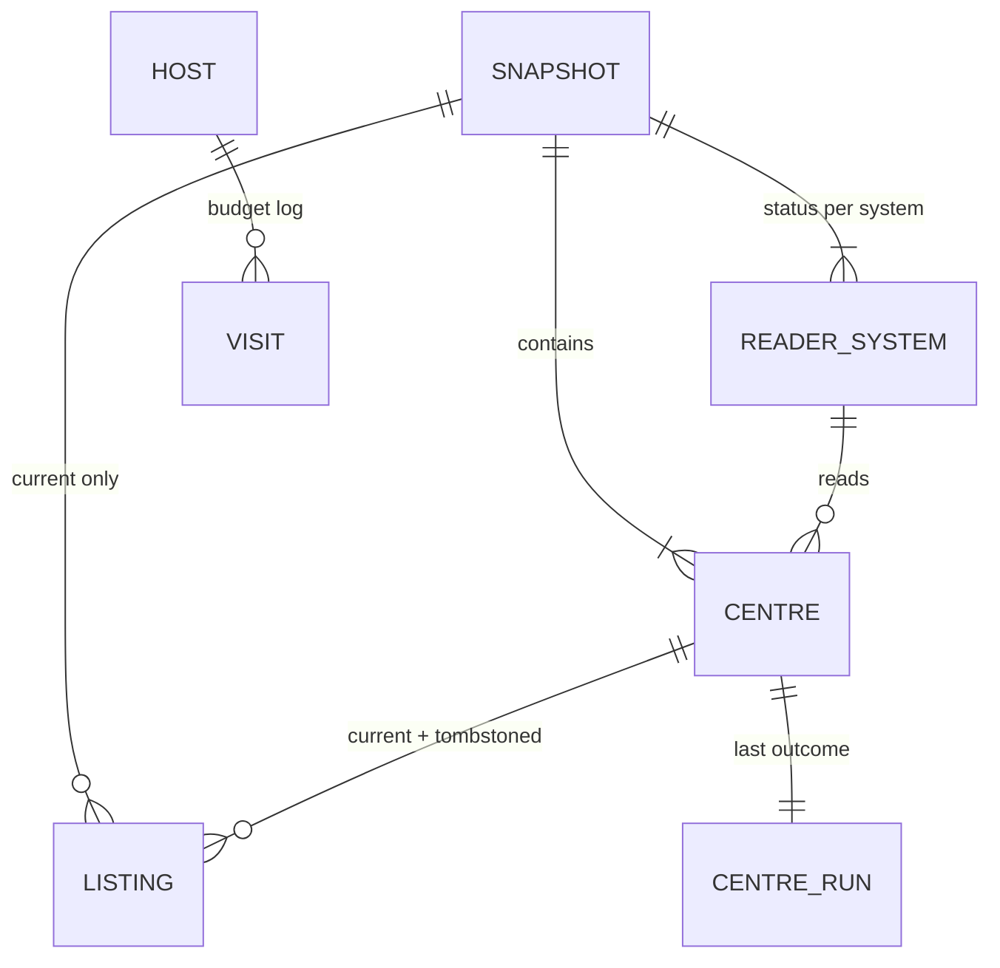

# Architecture Spine — bgtsearch

## Design Paradigm

**Pipes-and-filters batch pipeline → static snapshot → static client-side app.** Nothing runs when a user visits. A scheduled job runs the pipeline, commits state and snapshot, then deploys the site.



| Layer | Directory | Does |
| --- | --- | --- |
| shared | `shared/` | zod schemas, types, enum codes, `mapStatus`, place-name normaliser, haversine. |
| fetch | `pipeline/fetch/` | The only HTTP client (AD-5). |
| readers | `pipeline/readers/<system>/` | Pure parsers, one per booking system (AD-3). |
| stages | `pipeline/stages/` | normalise, locate, merge, publish. |
| web | `web/` | Static Preact app. |
| tools | `tools/` | Operator-run scripts: geocode, build-places, directory-diff. |

## Invariants & Rules



Arrows are the only allowed imports. `readers` never imports `fetch` or `stages`; `web` never imports `pipeline` or `tools`; no project code imports the `typescript` package.

### AD-1 — Static snapshot, no runtime backend [ADOPTED]

- **Binds:** all
- **Prevents:** an API, server function or database being added that sees user queries or costs money.
- **Rule:** The site is static files only. At visit time the browser fetches exactly two same-origin data files, `snapshot.json` and `places.json`. No server-side code, no analytics, no cookies, no third-party request at page load (Google Maps only on tap). Referrer policy `no-referrer`; external links `rel="noopener noreferrer"`.

### AD-2 — User location stays in the browser [ADOPTED]

- **Binds:** CAP-1, SPEC constraint "location never leaves the browser"
- **Prevents:** the host, a geocoder or a log receiving a typed place or coordinates.
- **Rule:** Place matching and distance (haversine, km) run in `web/`: a result card measures from its listing's coordinates, a no-dates or uncovered card from its centre's coordinates. Search state lives in the URL fragment only: `#q=…&r=…&sort=…&lang=…`, never the query string. Coordinates are never put in a URL, request or storage.

### AD-3 — Readers are pure functions over a shared shape [ADOPTED]

- **Binds:** CAP-2, CAP-3, CAP-5, CAP-10
- **Prevents:** the KuferWeb and ITEM KG readers differing on HTTP, clocks, status codes, date formats or "unknown".
- **Rule:**
  - A reader exports `plan(centre)` (list-page URLs, plus how to select detail pages, capped per centre) and `parse(pages, centre, ctx) → { kind: 'ok', listings: RawListing[] } | { kind: 'failed', reason }`.
  - `parse` does no I/O and keeps no state. Its only time source is `ctx.runAt` (used, for example, to infer a missing year).
  - `RawListing` is a zod schema in `shared/`: local wall-clock date and time, status via the shared `mapStatus` (precedence `waitlist` > `booked_out` > `free` > `unknown`), and `null` for every absent field.
  - Output that fails `RawListing` validation marks only that centre `failed('schema')`.
  - Readers parse with cheerio `load()` only, never `fromURL`.
  - Adding a booking system means adding a folder under `pipeline/readers/` that implements this interface.

### AD-4 — "Zero dates" requires proof [ADOPTED]

- **Binds:** CAP-5, CAP-10, SPEC "a gap must never read as nothing available"
- **Prevents:** a broken reader being shown as "No dates listed".
- **Rule:** A reader returns `ok` with zero listings only if it found its expected listing structure (each reader defines this check and has a "structure missing" fixture that must return `failed`). A non-2xx or timed-out list page makes the centre `failed` without calling `parse`.

### AD-5 — One polite HTTP path [ADOPTED]

- **Binds:** CAP-3, CAP-8, SPEC politeness constraint
- **Prevents:** a request reaching an opted-out or robots-disallowed site, or a site being visited more than 4 times a day.
- **Rule:** All outbound HTTP, pipeline and `tools/` alike, goes through `pipeline/fetch`. It:
  - skips centres with `opted_out` or reader `none` before any request;
  - checks robots.txt once per host per run;
  - sends `User-Agent: bgtsearch-bot/<version> (+<stable About URL>)`;
  - fetches serially per host with a delay and a timeout;
  - decodes the charset into strings;
  - refuses a host already visited 4 times in the last 24 h, using the visit log in `data/state/`. This also applies to manual and local reruns. Fetch only reads the log and returns this run's visits; merge persists them (AD-6).

  Detail-page fetch results set each listing's `link_ok`; there are no separate link-check requests. `pipeline/fetch` has exactly three robots exemptions, each an explicit per-client option passed only by its own tool:
  - `tools/geocode` calls only Nominatim's `/search` for centre addresses (manual, cached, ≤ 1 req/s, never scheduled). Nominatim's robots.txt targets crawlers, and its OSMF usage policy governs API use.
  - `tools/build-places` calls only Overpass's `https://overpass-api.de/api/interpreter` (manual, cached, serial, ≥ 10 s apart, never scheduled). Overpass's robots.txt disallows `/api/` for all bots; the exemption is an operator decision of 2026-10-27 (amendment, Story 1.5).
  - `pipeline/stages/locate` calls only Nominatim's `/search` (scheduled, but only for test addresses not yet in the `data/state/venues.json` cache, serial, ≤ 1 req/s, at most `LOCATE_MAX_LOOKUPS_PER_RUN` per run). It uses the same lookup and acceptance rules as `tools/geocode` (`pipeline/fetch/nominatim.ts`). A failed or skipped lookup never fails the run; the listing falls back to its centre's coordinates. Operator decision of 2026-10-30 (amendment, Story 2.10).

  Every other host and path keeps full robots checks. The 4-visits-in-24-h cap and the visit log apply to centre hosts; Nominatim and Overpass are limited by their usage rules instead (cached and paced; manual except locate's capped lookups of new test addresses).

### AD-6 — Run outcome and the single state writer [ADOPTED]

- **Binds:** CAP-3, CAP-5, CAP-6, CAP-8
- **Prevents:** stages updating history differently; `first_seen_at` resetting; skipped centres looking checked.
- **Rule:**
  - Each centre's run outcome is `ok`, `failed` or `skipped`. `skipped` covers opted out, reader `none`, robots disallow and budget exhausted.
  - Only `pipeline/stages/merge` writes `data/state/`, including the per-host visit log.
  - `ok` sets `last_checked_at`, `last_success_at` and `last_result=ok`, and replaces that centre's current listings.
  - `failed` sets `last_checked_at` and `last_result=failed` and keeps the previous listings unchanged.
  - `skipped` sets no timestamps.
  - A listing missing from an `ok` result gets `removed_at`, but stays in state until its `starts_at` passes. If it reappears, `removed_at` is cleared and `first_seen_at` is kept.
  - `first_seen_at` is set once and never changed. Listings found in a centre's first `ok` run are marked `baseline` and never shown as "new".
  - Merge also persists the test-address cache (`data/state/venues.json`) from locate's new lookups; locate only reads it.

### AD-7 — Listing identity [ADOPTED]

- **Binds:** CAP-6
- **Prevents:** provider URL edits or same-minute sessions corrupting "new".
- **Rule:** `normalise` alone builds the id `<centre_id>@<YYYY-MM-DDTHH:mm local>`. Sessions at the same centre and minute get suffixes `#2`, `#3` …, in order of `place`. The id never uses the provider URL.

### AD-8 — Directory is human-owned; every centre gets exactly one card type [ADOPTED]

- **Binds:** CAP-1, CAP-4, CAP-7, CAP-8, CAP-10
- **Prevents:** the pipeline overwriting opt-outs; a centre missing from results; a failing centre showing "No dates listed".
- **Rule:**
  - `data/directory/centres.json` is edited only by people, or by a `tools/` script whose output a person commits. The pipeline never writes it.
  - Each entry has `centre_id`, name, address, lat/lon, website, `test_page_url`, `reader`, an optional `reader_config` typed per reader, `opted_out`, `source` and `verified_at`.
  - Publish emits every directory centre with `coverage`: `not_checked` if the reader is `none`, opted out or robots-disallowed; otherwise `covered`. A `not_checked` centre publishes zero listings.
  - The web app picks the card from coverage first:
    - `not_checked` → uncovered card;
    - `covered` with current listings → one result card per listing whose own coordinates are in range (the centre is absent if none are);
    - `covered`, no listings, `last_result=ok` → no-dates card;
    - `covered`, no listings, `failed` or never run → uncovered card with the text "Not checked right now. See the centre's page."

### AD-9 — Two public data contracts [ADOPTED]

- **Binds:** CAP-1 to CAP-10
- **Prevents:** pipeline and UI drifting on field names; search features built on a guessed place table.
- **Rule:** Both files are zod schemas in `shared/`. Publish (and `tools/build-places`) refuse to emit an invalid file.
  - `snapshot.json` contains `{ schemaVersion, generated_at, systems[], centres[], listings[] }`:
    - each centre: directory fields, `coverage`, `last_result`, `last_checked_at`, `last_success_at`;
    - each system: `reader`, `centres_covered`, `centres_ok`, `centres_failed` and `last_success_at` (the latest run in which any of its centres was `ok`);
    - each listing: the fields in `data-sources.md`, without a per-listing `last_checked_at` (freshness is per centre). Its `address` is already filled from the centre address when the provider gives none, and it carries `lat`, `lon` (nullable) and `location` (`venue` | `centre`) from locate.
  - `places.json` contains rows `{ key, name, postcodes[], district, state, lat, lon }` covering all German municipalities and postcodes, plus a simplified Bavaria boundary polygon. Search only matches rows with `state = BY`; a non-Bavarian match, or a device location outside the polygon, gives the "Bavaria only" message. The nearest-town lookup uses only Bavarian rows. Every name match goes through the one shared normaliser (case, umlauts, ß).
  - A breaking change bumps `schemaVersion` and updates `web/` in the same commit. The app embeds the version it expects; on a mismatch it reloads once, then shows the load-error state.
  - No schema has a field for personal data, so none can be stored.

### AD-10 — Codes in data, words in translation files [ADOPTED]

- **Binds:** CAP-2, CAP-9
- **Prevents:** German or English words baked into data or components.
- **Rule:** `status`, `registration_method`, `reader`, `coverage` and `last_result` are fixed lowercase codes. All UI text comes from `web/src/i18n/{de,en}.json`; CI fails on missing or extra keys. Provider free text (place, room) is shown as published and marked `lang="de"` in the English UI.

### AD-11 — Time is stored raw; freshness is computed in the browser [ADOPTED]

- **Binds:** CAP-1, CAP-5, CAP-6
- **Prevents:** thresholds frozen into an hours-old snapshot; timezone mix-ups; showing a failing centre as recently checked.
- **Rule:**
  - `starts_at` is ISO 8601 with its Europe/Berlin offset. `deadline` is a local date or `null`. Run timestamps are UTC ISO 8601 (`Z`).
  - Publish drops listings with `starts_at ≤ runAt`, and `web/` hides `starts_at ≤ now` again.
  - The freshness line always shows the centre's `last_success_at`. It switches to the exact time when `now − last_success_at > 36 h`, and a system reads "Not updated since …" under the same 36 h test.
  - "New" means `now − first_seen_at < 24 h` and not `baseline`. "Passed" means `deadline < today`.
  - The 36 h freshness and 24 h "New" thresholds are constants in `shared/`. (Amended 2026-10-29: once-a-day collection.)

### AD-12 — Git is the database; one commit per run, then deploy [ADOPTED]

- **Binds:** CAP-3, CAP-6, operations
- **Prevents:** history loss, deploying data that was never saved, publishing against a stale directory, CI loops.
- **Rule:**
  - State and the published files live in `data/` on `main`. The bot writes only `data/state/` and `data/public/`, with atomic file writes, and commits both in one commit per run.
  - On a rejected push, the bot pulls upstream. If anything outside its two folders changed, it re-runs merge and publish from this run's saved reader results (no refetch) on top of the new upstream, then pushes.
  - Deploy runs only from the pushed SHA, and never if the push failed.
  - `pipeline.yml` triggers on schedule, on push to `main` and on `workflow_dispatch`. It uses one concurrency group with `cancel-in-progress: false`.
  - `ci.yml` (tests, lint, schema checks) ignores `data/state/**` and `data/public/**`, but validates `data/directory/**`.
  - Branch protection must let the bot push to `main`.

## Consistency Conventions

| Concern | Convention |
| --- | --- |
| Ids | `centre_id`: lowercase slug (`vhs-guenzburg`), stable forever. Listing id per AD-7. |
| Files | kebab-case; one reader per folder `pipeline/readers/<system>/` with `index.ts`, `fixtures/`, `*.test.ts`. |
| Package | One root `package.json` (no workspaces); `.nvmrc` pins Node. |
| Dates | ISO 8601 strings in JSON, never epoch numbers (AD-11). |
| Missing values | `null`, never `"unknown"` strings or omitted keys. |
| Errors | Reader failures are values, never thrown. Any error that would make a published file invalid fails the run, so the last good site stays deployed. |
| Logging | One line per centre per run: `centre_id`, reader, outcome, listing count, duration. No page content. |
| Config | Schedule, delays, timeouts, UA, budget in `pipeline/config.ts`. Secrets: the default workflow token, one repository secret for the dead-man ping URL, and a fine-grained token for the home fallback. |
| Tests | Readers against committed HTML fixtures, including a "structure missing" one (AD-4). Merge tests cover tombstones, baseline, same-minute ids. |
| Indexing | `noindex` meta while in private beta. |

## Stack

| Name | Version |
| --- | --- |
| Node.js (LTS) | 26.x |
| TypeScript | 6.0 |
| Vite | 8.3 |
| Preact (starter: `npm create preact`, without its ESLint option) | 11.0 |
| @preact/preset-vite | 2.10 |
| cheerio | 1.2 |
| zod | 4.6 |
| Vitest | 5.0 |
| GitHub Actions (public repo, standard runners) | n/a (hosted) |
| GitHub Pages (`actions/deploy-pages`) | n/a (hosted) |

## Structural Seed

### Deployment and environments



- **Environments:** local (`npm run pipeline`, `npm run dev`) and production. Private beta = production, unlisted, `noindex`, Impressum/Privacy links hidden.
- **Monitoring:** any failed run opens or updates a GitHub issue. Each run pings an external dead-man check, which alerts if no ping arrives for 13 h. GitHub's 60-day inactivity email is the last resort; re-enable via `workflow_dispatch` / the Actions tab.
- **Fallback:** if centre sites block GitHub's IPs, a home machine runs `npm run pipeline` on cron and pushes with a fine-grained token; deploy still runs on GitHub. No self-hosted runner on the public repo.
- **Recovery:** git history is the backup; reverting `data/` to an earlier commit restores state.
- **Cost:** €0. A custom domain is the only optional paid item.

### Core entities



### Source tree

```text
bgtsearch/
  shared/                    # schemas, codes, mapStatus, normaliser, constants
  pipeline/
    fetch/                   # AD-5
    readers/kuferweb/        # AD-3, AD-4
    readers/itemkg/
    stages/                  # normalise, merge, publish
    config.ts
  web/                       # Vite + Preact
    src/i18n/{de,en}.json
  tools/                     # geocode, build-places, directory-diff
  data/
    directory/centres.json   # human-owned (AD-8)
    state/                   # bot-owned (AD-6, AD-12)
    public/                  # snapshot.json, places.json
  .github/workflows/         # pipeline.yml, ci.yml, directory-monthly.yml
```

## Capability → Architecture Map

| Capability | Lives in | Governed by |
| --- | --- | --- |
| CAP-1 search, radius, sort | `web/`, `places.json`, `pipeline/stages/locate` | AD-1, AD-2, AD-5, AD-9, AD-11 |
| CAP-2 listing fields, link fallback | `shared/`, `pipeline/stages/normalise`, `web/` | AD-3, AD-5, AD-9, AD-10 |
| CAP-3 automatic collection | `pipeline/`, `pipeline.yml` | AD-3, AD-5, AD-6, AD-12 |
| CAP-4 uncovered centres | `pipeline/stages/publish`, `web/` | AD-8 |
| CAP-5 freshness, failing reader | `pipeline/stages/merge`, `web/` | AD-4, AD-6, AD-8, AD-11 |
| CAP-6 "new" badge | `pipeline/stages/merge`, `web/` | AD-6, AD-7, AD-11 |
| CAP-7 directory | `data/directory/`, `tools/` | AD-8 |
| CAP-8 opt-out | `data/directory/`, `pipeline/fetch` | AD-5, AD-6, AD-8 |
| CAP-9 DE/EN | `web/src/i18n/` | AD-10 |
| CAP-10 no-dates card | `pipeline/readers`, `web/` | AD-4, AD-8 |

## Deferred

- **Places dataset source:** resolved in Story 1.5 as OpenStreetMap via the Overpass API (ODbL), queried by `tools/build-places` (AD-5 exemption). AD-9 fixes the shape. Revisit if `places.json` exceeds ~300 KB gzipped (then lazy-load or split).
- **Dead-man check provider:** pick a free one at setup; AD-12/monitoring fixes that it exists.
- **Snapshot splitting:** one file until it passes ~1 MB.
- **Custom domain, Impressum operator, privacy policy text:** before public launch. The policy must name GitHub Pages as host.
- **Readers for further systems:** follow AD-3/AD-4; no architecture change.
- **v2 alerts:** built on `data/state/` history; any backend must revisit AD-1.
- **Moving data off `main`:** only if repo size or push races become a real problem.
- **Switch to the official BAMF list:** directory `source` field (AD-8) carries the change; covered by its own story.
